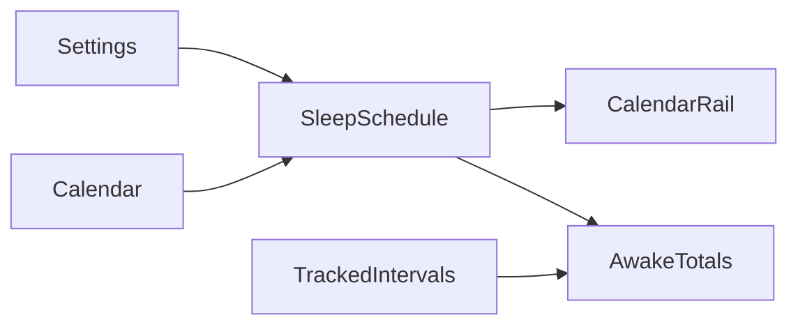

# Requirements

### Goal

Design the full Sleep Schedule feature and align it with the Calendar progress rail, so planned wake and bed times have one shared source and the rail reflects that plan.

### Scope

- Include configurable planned wake and bed times, actual wake and bed records, awake time derived from existing idle intervals, and Calendar integration.
- Keep raw idle intervals and focus session records unchanged, including sessions that occur during planned sleep.
- Keep planned times read only in Calendar. Calendar uses the shared schedule for planned events and the vertical progress rail.
- Keep storage local to the browser profile. Account ownership, server storage, and cross device sync remain out of scope, consistent with specs 0005 and 0007.

# Technical Design

### Current implementation

- `docs/specs/web/0005-idle-session-overrun/index.md` establishes local persisted `TrackedInterval` records and says a future sleep schedule may derive awake time without changing raw intervals.
- `docs/specs/web/0007-calendar-planner/index.md` AC-7 expects Calendar to read planned Wake Up and Go to Bed times, but its data model currently places actual `SleepEventRecord` items in Calendar state.
- `web/src/features/calendar/types/calendar.ts` and `web/src/features/calendar/stores/calendar-store.ts` define and persist those actual records with the calendar data. `web/src/features/calendar/services/calendar-coordinator.ts` is the established pattern for serialized local writes and cross tab updates.
- `web/src/app/routes/(root)/Calendar.tsx` currently adds a day progress background from local midnight to now. `web/src/app/routes/(root)/calendar.css` styles that background and the current time marker; the planned sleep rail is not yet implemented.
- `web/src/features/settings/calendar/Index.tsx` is an existing Settings section. `web/src/features/ui/navigation/Sidebar/Settings/constants/links.tsx` defines Settings navigation, and `web/src/app/layout/Settings.tsx` hosts shared Settings behavior.

### Key decision

Use a dedicated Sleep Schedule feature as the canonical owner of planned wake and bed values and actual sleep records. Calendar consumes the shared values and sends sleep record changes through the Sleep Schedule interface instead of keeping a second copy. This follows the feature boundary in scope item 47 and avoids splitting the source of truth between Settings and Calendar.

### Proposed design work

Define the schedule data model and its time rules, actual event lifecycle, awake time derivation from `TrackedInterval`, persistence and migration, and the interface used by Settings and Calendar. Record how missing settings, local dates, schedules crossing midnight, past and future dates, and unavailable or invalid values behave. Keep the existing Calendar and timer coordination patterns as references, then specify the canonical owner and the required migration away from Calendar owned sleep records.

### Architecture diagram

### Documents to align

- Add the Sleep Schedule design under `docs/specs/web/`, using the next available number after 0007.
- Update `docs/specs/web/0007-calendar-planner/index.md` so AC-7, data ownership, value sourcing, invariants, and the build plan point to the shared Sleep Schedule contract.
- Update the matching Sleep Schedule and Calendar entries in `docs/scope/web/scope.md` to link their specs and show the dependency clearly.
- Leave accepted spec 0005 unchanged; it is the source contract for raw idle intervals.

# Validation

### Design consistency checks

- Confirm every displayed planned or actual sleep value has a named source and time zone rule in the Sleep Schedule spec.
- Confirm awake totals are derived from raw tracked intervals and do not rewrite idle or session records.
- Confirm Calendar has one shared source for planned values and actual sleep records, with no duplicate settings model.
- Confirm Calendar AC-7, its build plan, and the Sleep Schedule scope row agree on the integration boundary and behavior.

# Delivery Steps

### ✓ Step 1: Settle Sleep Schedule requirements and data contract

The Sleep Schedule feature has a complete, buildable product and data contract.

- Use the scope intent and Calendar AC-7 to define planned wake and bed settings, actual sleep event behavior, and awake time derived from existing `TrackedInterval` records.
- Settle schedule cadence, local date and time handling, overnight windows, past and future event rules, defaults, validation, and empty or invalid setting behavior.
- Define the Sleep Schedule data model, persistence and migration, event lifecycle, and local only privacy boundary without changing raw idle intervals or completed sessions.

### ✓ Step 2: Define the Sleep Schedule and Calendar boundary

Settings and Calendar use one canonical Sleep Schedule source, with explicit read and write contracts.

- Assign planned times and actual sleep records to the Sleep Schedule feature, using its persisted state and command boundary as the canonical source.
- Define how the Settings surface edits planned values and how Calendar reads planned values, renders sleep events and the rail, and records actual event times.
- Specify migration of the provisional `SleepEventRecord` data from `web/src/features/calendar/stores/calendar-store.ts` and preserve the existing serialized local write and cross tab guarantees.

### ✓ Step 3: Write and align the web design records

The Sleep Schedule has a linked spec, and the Calendar spec and scope describe the same integration contract.

- Create the Sleep Schedule spec under `docs/specs/web/` using the next number after 0007 and the agreed model and behaviors.
- Update `docs/specs/web/0007-calendar-planner/index.md` to replace provisional Calendar ownership with the shared Sleep Schedule contract and retain the rail's planned time behavior.
- Update `docs/scope/web/scope.md` to link the Sleep Schedule spec and express the Calendar dependency.
- Check the value sources, local persistence boundary, migration requirements, and cross references across all three documents.
